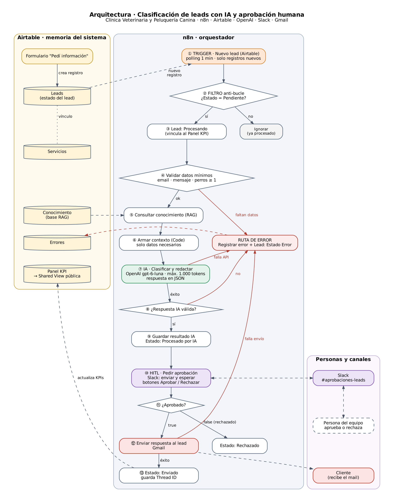

# Entrega Final · Ecosistema de automatización IA

Clasificación de leads con IA y aprobación humana · Clínica Veterinaria y Peluquería Canina

Oct 15, 2026 · @emi

## Propuesta

El sistema recibe cada consulta de un cliente nuevo, la clasifica con IA como VIP o Normal, redacta una respuesta con información validada de la clínica y solo la envía cuando una persona la aprueba en Slack.

**Negocio (ficticio):** Clínica Veterinaria y Peluquería Canina en Bahía Blanca. Ofrece baño y corte, plan mensual de peluquería, vacunación, desparasitación y consulta clínica.

**Problema:** las consultas llegan por un formulario web y se responden a mano, tarde y sin criterio. Los clientes de mayor valor (varios perros o plan mensual) esperan lo mismo que una consulta suelta.

**Solución:** un flujo automático de punta a punta que lee el lead desde la base de datos, lo procesa con IA, pide aprobación humana y responde por mail, registrando cada paso y cada error.

### Las 4 categorías de tecnología

| Categoría | Herramienta | Función en el sistema |
| --- | --- | --- |
| Orquestador | n8n | Flujo principal: disparo, validación, IA, aprobación, envío y rutas de error |
| Base de datos | Airtable | Memoria del sistema: leads, servicios, conocimiento (RAG), errores y KPIs |
| Procesamiento IA | OpenAI · gpt-6-luna | Clasifica el lead y redacta la respuesta con RAG, salida en JSON |
| Canal de salida | Slack + Gmail | Slack para la aprobación humana; Gmail para responder al cliente |

### Criterio de clasificación

- **VIP:** el lead tiene 2 o más perros, o pide el plan mensual de peluquería.
- **Normal:** cualquier otro caso.
- La IA devuelve además un puntaje de 1 a 10 y el motivo de la clasificación, para que quien aprueba entienda la decisión.

### Ciclo de estados del lead

`Pendiente → Procesando → Procesado por IA → Enviado` (aprobado) o `→ Rechazado` (no aprobado). Cualquier falla lleva el lead a `Error` y deja un registro en la tabla Errores.

## 1. Mapa de arquitectura

Un solo flujo de n8n de 13 pasos lleva el lead desde el formulario hasta el mail al cliente, con una ruta de error que lo frena en 4 puntos y una pausa humana antes del envío.



### Recorrido nodo por nodo

| # | Nodo en n8n | Tipo | Qué hace |
| --- | --- | --- | --- |
| 1 | Trigger · Nuevo lead (Airtable) | Airtable Trigger | Revisa cada 1 minuto solo los registros nuevos, usando el campo Fecha creación |
| 2 | FILTRO · ¿Estado Pendiente? | IF | Corta el flujo si el lead ya fue procesado (anti-bucle) |
| 3 | Lead: Procesando | Airtable Update | Cambia el Estado, lo vincula al Panel KPI y anota la Última ejecución |
| 4 | Validar datos mínimos | IF | Exige email, mensaje y cantidad de perros mayor o igual a 1 |
| 5 | Consultar conocimiento (RAG) | Airtable Search | Lee la tabla Conocimiento con la información validada de la clínica |
| 6 | Armar contexto | Code | Une el conocimiento y arma un paquete mínimo de datos para la IA |
| 7 | IA · Clasificar y redactar | OpenAI | Devuelve un JSON con categoría, puntaje, motivo, asunto y respuesta |
| 8 | ¿Respuesta IA válida? | Code + IF | Controla que el JSON esté completo y bien formado |
| 9 | Guardar resultado IA | Airtable Update | Guarda la clasificación y el borrador; Estado = Procesado por IA |
| 10 | HITL · Pedir aprobación | Slack (enviar y esperar) | Publica el borrador en #aprobaciones-leads con botones Aprobar / Rechazar |
| 11 | ¿Aprobado? | IF | Compara el booleano de la respuesta de Slack |
| 12 | Enviar respuesta al lead | Gmail | Manda el mail al cliente con el asunto y el texto aprobados |
| 13 | Estado: Enviado | Airtable Update | Guarda el Thread ID de Gmail y cierra el ciclo |

Las rutas en rojo del diagrama terminan en **Registrar error**: crea un registro en la tabla Errores y pasa el lead a Estado = Error.

### Video demo

Video de hasta 3 minutos con el trigger, el procesamiento en n8n, la aprobación en Slack y el mail recibido: **\[PEGAR ENLACE — YouTube no listado, Loom o Drive\]**

## 2. Manual operativo de datos

La base de Airtable **Veterinaria – Leads** reúne las 5 tablas del sistema: 4 vinculadas entre sí y Conocimiento, que el flujo lee como base RAG. Ningún dato queda aislado: cada lead se vincula a su servicio, a sus errores y al panel de KPIs.

### Relaciones entre tablas

| Tabla | Se vincula con | Tipo de relación | Para qué sirve |
| --- | --- | --- | --- |
| Leads | Servicios | Muchos leads → 1 servicio | Saber qué servicio pidió cada lead |
| Leads | Errores | 1 lead → muchos errores | Rastrear cada falla hasta su lead |
| Leads | Panel KPI | Muchos leads → 1 panel | Calcular los KPIs con rollups |
| Conocimiento | (leída por n8n) | Fuente RAG | Única información que la IA puede usar |

### Tabla Leads (memoria principal)

| Campo | Tipo | Quién lo completa | Uso |
| --- | --- | --- | --- |
| Nombre | Texto (principal) | Formulario | Saludo del mail |
| Email | Email | Formulario | Destinatario del mail |
| Teléfono | Teléfono | Formulario | Contacto; nunca se envía a la IA |
| Cantidad de perros | Número entero | Formulario | Criterio VIP; validado como número |
| Servicio de interés | Vínculo a Servicios | Formulario | Servicio pedido |
| Servicio (nombre) | Lookup de Servicios | Airtable | Texto del servicio para la IA |
| Mensaje | Texto largo | Formulario | Consulta del cliente |
| Estado | Selección única | n8n | Pendiente / Procesando / Procesado por IA / Enviado / Rechazado / Error (valor por defecto: Pendiente) |
| Categoría IA | Selección única | n8n | VIP / Normal |
| Puntaje IA | Número | n8n | 1 a 10 |
| Motivo IA | Texto largo | n8n | Por qué la IA eligió esa categoría |
| Asunto propuesto | Texto | n8n | Asunto del mail |
| Borrador respuesta | Texto largo | n8n | Texto que revisa el humano |
| Decisión humana | Selección única | n8n | Aprobado / Rechazado |
| Thread ID Gmail | Texto | n8n | Hilo del mail enviado |
| Panel | Vínculo a Panel KPI | n8n | Alimenta los KPIs |
| Errores | Vínculo a Errores | n8n | Fallas de este lead |
| Fecha creación | Fecha de creación | Airtable | Campo que vigila el trigger |
| Última ejecución | Fecha y hora | n8n | Se actualiza en cada paso |
| Es aprobado / Es rechazado / Es enviado / Es error | Fórmula (1 o 0) | Airtable | Base de los KPIs |

### Tablas Servicios, Errores, Panel KPI y Conocimiento

| Tabla | Campos | Contenido |
| --- | --- | --- |
| Servicios | Nombre, Categoría, Descripción, Leads (vínculo) | Baño y corte, Plan mensual de peluquería, Vacunación, Desparasitación, Consulta clínica |
| Errores | ID (autonumérico), Fecha, Nodo, Tipo, Mensaje, Lead (vínculo) | Tipo: Datos incompletos / Falla API IA / Respuesta IA inválida / Falla envío Gmail |
| Panel KPI | Nombre, Leads (vínculo), contadores y fórmulas | Un único registro, "Panel general" (ver criterio 5) |
| Conocimiento | Tema, Categoría, Contenido | Un tema por registro: servicios, horarios, cómo pedir turno, plan mensual, tono de marca |

### Esquemas JSON de transferencia

Cada integración pasa un JSON al siguiente nodo. Los valores son de ejemplo.

**A. Airtable → n8n (salida del Trigger).** Los campos llegan dentro de `fields`; un vínculo llega como lista de IDs y un lookup como lista de textos.

```json
{
  "id": "recA1b2C3d4E5f6G7",
  "createdTime": "2026-10-20T13:05:12.000Z",
  "fields": {
    "Nombre": "Laura",
    "Email": "laura.prueba@example.com",
    "Teléfono": "+54 9 291 555-0101",
    "Cantidad de perros": 2,
    "Servicio de interés": ["recServ01PlanMens"],
    "Servicio (nombre)": ["Plan mensual de peluquería"],
    "Mensaje": "Tengo dos caniches y quiero saber cómo funciona el plan mensual.",
    "Estado": "Pendiente"
  }
}
```

**B. n8n → OpenAI (variables que recibe el prompt).** Solo viaja lo necesario para clasificar: nombre, email y teléfono nunca llegan a OpenAI.

```json
{
  "lead_id": "recA1b2C3d4E5f6G7",
  "cantidad_perros": 2,
  "servicio": "Plan mensual de peluquería",
  "mensaje": "Tengo dos caniches y quiero saber cómo funciona el plan mensual.",
  "contexto": "Plan mensual de peluquería: ...\nCómo pedir turno: ...\nTono de marca: ..."
}
```

**C. OpenAI → n8n (respuesta de la IA en `message.content`).** El prompt exige exactamente estas 5 claves.

```json
{
  "categoria": "VIP",
  "puntaje": 9,
  "motivo": "Tiene 2 perros y pide el plan mensual.",
  "asunto": "Tu plan mensual de peluquería",
  "respuesta": "¡Gracias por escribirnos! El plan mensual incluye..."
}
```

**D. Slack → n8n (respuesta del nodo de aprobación).** El nodo devuelve un booleano; si la persona rechaza, llega false en lugar de `true`.

```json
{
  "data": {
    "approved": true,
    "respondedAt": "2026-10-15T19:04:55.444Z"
  }
}
```

**E. Gmail → n8n (salida del envío).** El `threadId` se guarda en Airtable para responder dentro del mismo hilo.

```json
{
  "id": "19a2f0c4d7e8b123",
  "threadId": "19a2f0c4d7e8b123",
  "labelIds": ["SENT"]
}
```

**F. n8n → Airtable (registro de error).**

```json
{
  "Fecha": "2026-10-20T13:06:40.000Z",
  "Nodo": "IA · Clasificar y redactar",
  "Tipo": "Falla API IA",
  "Mensaje": "401 Incorrect API key provided",
  "Lead": ["recA1b2C3d4E5f6G7"]
}
```

## 3. Optimización de costos

Con gpt-6-luna, procesar 1.000 leads cuesta unos USD 0,33, un 95% menos que con un modelo de gama media. Las 5 a 10 ejecuciones de prueba de esta entrega cuestan menos de un centavo.

### Matriz de decisión: qué modelo para cada tarea

| Tarea | Frecuencia | Modelo elegido | Por qué |
| --- | --- | --- | --- |
| Validar datos mínimos | Cada lead | Sin IA (nodo IF) | Es una regla fija: una IA agregaría costo y errores sin beneficio |
| Clasificar y redactar la respuesta | Cada lead | OpenAI gpt-6-luna · máx. 1.000 tokens · respuesta en JSON | Tarea corta con criterio simple y contexto chico; es el modelo más barato de OpenAI |
| Reclasificar la base histórica o una campaña | Mensual, cientos de leads | gpt-6-luna vía Batch API | No es urgente; el lote cuesta la mitad y responde dentro de 24 h |
| Lectura densa (ej. historia clínica o PDF largo adjunto) | Ocasional, fuera del MVP | Claude Sonnet 5.5 | Ventana de contexto grande para documentos extensos; solo se paga cuando hace falta |
| Respaldo si la API de OpenAI falla | Excepcional | Claude Haiku 5.5 | Mismo precio que gpt-6-luna y otro proveedor, para no depender de uno solo |

### Costo estimado por lead

Supuesto: cada lead usa unos 1.500 tokens de entrada (instrucciones + base de conocimiento + consulta) y 350 de salida (el JSON con la respuesta).

| Modelo | Entrada (USD por millón) | Salida (USD por millón) | Por lead (USD) | Por 1.000 leads (USD) |
| --- | --- | --- | --- | --- |
| gpt-6-luna vía Batch | 0,05 | 0,25 | 0,00016 | 0,16 |
| **gpt-6-luna (elegido)** | **0,10** | **0,50** | **0,00033** | **0,33** |
| Claude Haiku 5.5 | 0,10 | 0,50 | 0,00033 | 0,33 |
| gpt-6.1-sol | 2,00 | 10,00 | 0,0065 | 6,50 |
| Claude Sonnet 5.5 | 2,00 | 10,00 | 0,0065 | 6,50 |
| gpt-6-astra | 10,00 | 50,00 | 0,0325 | 32,50 |

### Ahorro estimado

- **95% menos** que un modelo de gama media (USD 0,33 contra 6,50 cada 1.000 leads) y **99% menos** que el modelo más potente (USD 32,50).
- **50% adicional** en procesos masivos con Batch API.
- **Sin costo de IA** en los leads que fallan la validación: el flujo se corta antes de llamar a OpenAI.
- **Límite de 1.000 tokens de salida:** el costo máximo por lead queda acotado aunque el modelo intente extenderse.

Precios de lista consultados el 15 de octubre de 2026: [OpenAI](https://developers.openai.com/api/docs/pricing) · [Anthropic](https://platform.claude.com/docs/en/about-claude/pricing). Los modelos Claude cuentan los tokens distinto, así que su costo real puede variar algo.

## 4. Seguridad y resiliencia

Ningún mail sale sin aprobación humana, la IA nunca recibe datos de contacto y cada falla queda registrada con el nodo y el motivo.

### Minimización de datos

| Dato | ¿Llega a la IA? | ¿Llega a Slack? | Motivo |
| --- | --- | --- | --- |
| Nombre | No | Sí, solo el nombre de pila | La IA no lo necesita; n8n lo agrega al saludo del mail |
| Email | No | No | Solo lo usa el nodo de Gmail |
| Teléfono | No | No | No interviene en el flujo |
| Cantidad de perros, servicio y mensaje | Sí | Sí | Son lo mínimo para clasificar y redactar |

- Las claves de OpenAI, Slack, Gmail y Airtable se guardan en las credenciales de n8n; ningún nodo las escribe en texto.
- El canal de Slack es privado y solo están las personas que aprueban.
- El Dashboard público muestra la tabla Panel KPI, que no tiene datos personales. La tabla Leads se comparte en una vista de solo lectura sin Email ni Teléfono.
- El prompt de sistema prohíbe usar información fuera del contexto: la IA no puede inventar precios, horarios ni servicios.

### Rutas de error (Error Handlers)

En n8n, la directiva **Resume** de Make equivale a la opción *On Error → Continue (using error output)*: el nodo falla, pero el flujo sigue por una salida de error. **Break** equivale a *Stop Workflow*.

| Punto de falla | Cómo se detecta | Qué hace el flujo |
| --- | --- | --- |
| Faltan email, mensaje o cantidad de perros | IF «Validar datos mínimos» | Registra "Datos incompletos" y pasa el lead a Error; no llama a la IA |
| La API de OpenAI falla (clave, crédito, caída) | Salida de error del nodo de IA (Continue using error output) | Registra "Falla API IA" con el mensaje del error; el lead queda en Error |
| La IA devuelve un JSON roto o incompleto | Code + IF «¿Respuesta IA válida?» | Registra "Respuesta IA inválida"; no se le muestra nada al humano |
| Gmail no puede enviar | Salida de error del nodo de Gmail | Registra "Falla envío Gmail"; el lead queda en Error para reintentar a mano |
| Nadie responde en Slack todavía | La ejecución queda en espera | El lead sigue en Procesado por IA y no sale nada: el mail solo se envía con un Aprobar explícito |

El nodo de IA tiene además *Retry On Fail* con 2 reintentos, para que un corte momentáneo no termine en error.

### Punto Human-in-the-loop

1. Con el borrador guardado, n8n publica en Slack la categoría, el puntaje, el motivo, el servicio y el texto propuesto.
2. El mensaje trae los botones **Aprobar** y **Rechazar**, y el flujo queda en pausa hasta que alguien elige.
3. Solo si la respuesta es `approved = true` el flujo llega al nodo de Gmail. Cualquier otro caso termina en Rechazado.

Así se evita el "efecto metralleta": la IA nunca contacta al cliente por su cuenta.

### Check de seguridad antes de enviar

| Pregunta | Respuesta |
| --- | --- |
| ¿Hay un filtro contra bucles infinitos? | Sí: el trigger solo toma registros nuevos, el IF corta todo lead que no esté en Pendiente y el estado cambia a Procesando antes de cualquier otro paso |
| ¿Se comparan tipos de datos correctos? | Sí: cantidad de perros es número contra número (≥ 1), y la aprobación y la validez del JSON son booleano contra booleano |
| ¿El prompt es dinámico y usa variables? | Sí: recibe `{{ $json.cantidad_perros }}`, `{{ $json.servicio }}`, `{{ $json.mensaje }}` y `{{ $json.contexto }}` en cada ejecución |

## 5. Dashboard de control

La tabla Panel KPI calcula sola los 3 KPIs obligatorios a partir de los leads vinculados, y se publica como Shared View de solo lectura.

**Enlace público a la Shared View:** [Dashboard de control · Panel KPI](https://airtable.com/appKQlv5Lk7r09PVh/shr6cv2dVvK2CPJd2)

### KPIs del sistema

| KPI | Qué mide | Fórmula en Airtable |
| --- | --- | --- |
| Tasa de aprobación | Qué parte de los borradores revisados aprobó el humano | `IF({Aprobados}+{Rechazados}=0, 0, ROUND(100*{Aprobados}/({Aprobados}+{Rechazados}), 1))` |
| Volumen de salida | Cuántos mails se enviaron a clientes | `{Enviados}` |
| Tasa de error | Qué parte de los leads terminó en una ruta de error | `IF({Total leads}=0, 0, ROUND(100*{Errores}/{Total leads}, 1))` |
| Leads VIP (extra) | Cuántos leads fueron clasificados como VIP | `{VIP}` |

Las tasas se expresan en porcentaje (de 0 a 100) y el `IF` evita la división por cero mientras no haya datos.

### Cómo se calculan

1. En **Leads**, cuatro fórmulas devuelven 1 o 0: `IF({Decisión humana}="Aprobado",1,0)`, `IF({Decisión humana}="Rechazado",1,0)`, `IF({Estado}="Enviado",1,0)` e `IF({Estado}="Error",1,0)`. Una quinta marca los VIP: `IF({Categoría IA}="VIP",1,0)`.
2. El nodo «Lead: Procesando» vincula cada lead al registro "Panel general" de **Panel KPI**.
3. En **Panel KPI**, un campo *Count* da el Total leads y cinco campos *Rollup* con `SUM(values)` suman Aprobados, Rechazados, Enviados, Errores y VIP.
4. Las fórmulas de la tabla de arriba calculan las tasas.

Como el panel lee los mismos registros que escribe el flujo, los KPIs se actualizan solos en cada ejecución.

## Evidencias y enlaces

El flujo se ejecutó 6 veces el 18 de octubre de 2026: 3 por el camino feliz y 3 por caminos de error. Las 6 terminaron en el resultado esperado y quedaron registradas en Airtable.

### Enlaces en modo lectura

| Recurso | Enlace |
| --- | --- |
| Base de datos (vista de solo lectura de Leads, sin email ni teléfono) | [Leads · vista de solo lectura](https://airtable.com/appKQlv5Lk7r09PVh/shrPiTnhaOWvlK00k) |
| Dashboard de control (Shared View de Panel KPI) | [Dashboard de control · Panel KPI](https://airtable.com/appKQlv5Lk7r09PVh/shr6cv2dVvK2CPJd2) |
| Video demo (hasta 3 min) | \[PEGAR ENLACE\] |
| JSON del flujo en Google Drive (opcional, con permiso de lectura) | \[PEGAR ENLACE\] |

### Test de estrés: plan de pruebas

| # | Prueba | Datos de entrada | Resultado esperado | Resultado obtenido |
| --- | --- | --- | --- | --- |
| 1 | Camino feliz · VIP por cantidad | Martina · 3 perros · Baño y corte | VIP → aprobado en Slack → mail enviado → Estado Enviado | ✅ VIP (8/10) → aprobado → mail enviado con Thread ID → Enviado |
| 2 | Camino feliz · Normal | Juan · 1 perro · Vacunación | Normal → aprobado → mail enviado → Estado Enviado | ✅ Normal (5/10) → aprobado → mail enviado con Thread ID → Enviado |
| 3 | VIP por plan, rechazado | Sofía · 2 perros · Plan mensual | VIP → rechazado en Slack → no sale mail → Estado Rechazado | ✅ VIP (10/10) → rechazado → sin mail ni Thread ID → Rechazado |
| 4 | Camino infeliz · sin email | Pedro · 2 perros · registro sin Email | Ruta de error → "Datos incompletos" → no se llama a la IA | ✅ Error "Datos incompletos" registrado · sin llamada a la IA ni a Slack |
| 5 | Camino infeliz · dato inválido | Lucía · Cantidad de perros = 0 | Ruta de error → "Datos incompletos" (comparación numérica) | ✅ Error "Datos incompletos" registrado (0 ≥ 1 es falso) |
| 6 | Camino infeliz · falla de API | Jorge · lead normal, con el nodo de IA apuntando a un modelo inexistente | Salida de error del nodo IA → "Falla API IA" en Errores | ✅ 3 reintentos y salida de error → "Falla API IA" con el mensaje de OpenAI ("The resource you are requesting could not be found") |

### Prompt estructurado del nodo de IA

**Mensaje de sistema:**

```text
Sos el asistente comercial de la Clínica Veterinaria y Peluquería Canina. Clasificás consultas de clientes nuevos y redactás la respuesta.

Reglas:
1. Usá EXCLUSIVAMENTE la información del CONTEXTO. No inventes precios, horarios, servicios ni promociones. Si falta un dato, invitá a consultarlo por WhatsApp.
2. Categoría VIP si la cantidad de perros es 2 o más, o si el servicio es "Plan mensual de peluquería". En cualquier otro caso, Normal.
3. Puntaje de 1 a 10 según el valor potencial del cliente.
4. Respuesta: tono cercano, cálido y profesional; máximo 120 palabras; sin saludo ni firma (el sistema los agrega); terminá invitando a pedir turno.
5. Devolvé SOLO un objeto JSON con las claves: categoria, puntaje, motivo, asunto, respuesta.
```

**Mensaje de usuario (dinámico):**

```text
CANTIDAD DE PERROS: {{ $json.cantidad_perros }}
SERVICIO DE INTERÉS: {{ $json.servicio }}
MENSAJE DEL CLIENTE: {{ $json.mensaje }}

CONTEXTO:
{{ $json.contexto }}
```

### Capturas de las ejecuciones

- [ ] Lienzo completo del flujo en n8n —
- [ ] Pestaña Executions con las 6 ejecuciones — 
- [ ] Mensaje de aprobación en Slack con los botones y la respuesta elegida —
- [ ] Mail recibido por el cliente de prueba — 
- [ ] Tabla Leads con leads en distintos estados — 
- [ ] Tabla Errores con los registros del camino infeliz — 
- [ ] Panel KPI con los 3 KPIs calculados —

### JSON del flujo


